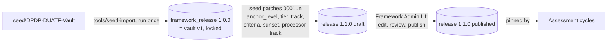
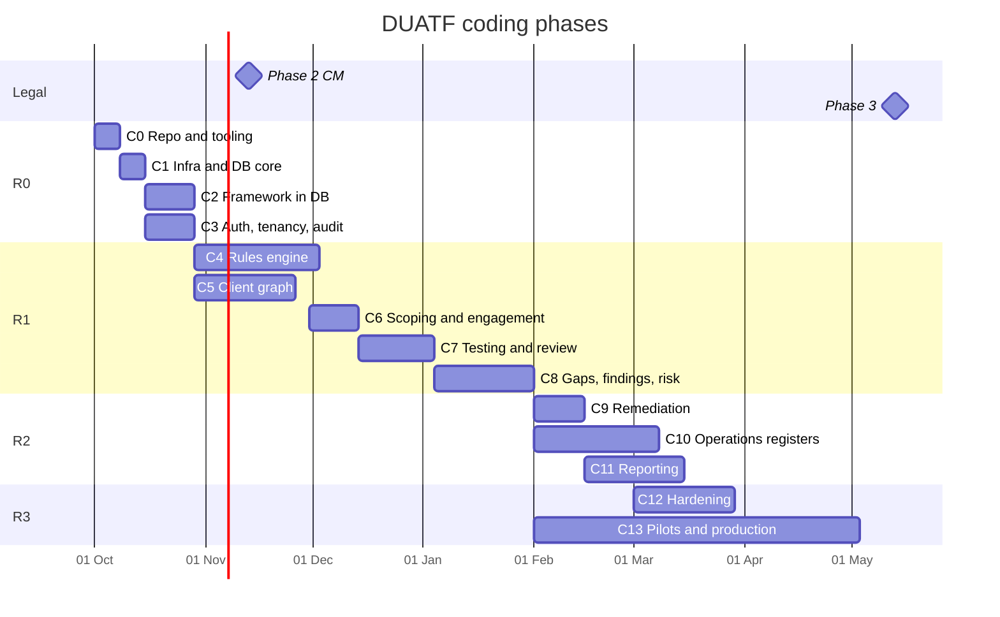

# DUATF GRC Platform: Coding Plan (v1.0, 30 Sep 2026)

This is the build plan for the DUATF GRC web application. It replaces the delivery part (sections 11-13) of `DUATF-GRC-Platform-Plan.md`. The business flow, rules and data model in that document still hold, except where this plan changes them.

**What changed from the first plan**
1. **The database is the source of truth.** The framework content (Act, Rules, obligations, controls, catalogue, overlays, vocabularies, playbooks) lives in PostgreSQL as versioned framework releases.
   - The Obsidian vault is used **once**, as seed input. A one-time importer reads it into the database.
   - After that, the framework is maintained in the app's Framework Admin module.
   - Obsidian import/export is not a requirement, and no feature depends on the vault.
2. **v0.2 framework changes are done in the app,** not by editing notes. These are anchor levels, tiers, tracks, acceptance criteria, sunset dates, the Interpretation Log and the processor track. They are delivered as seed patches (versioned data migrations) plus the admin UI.
3. **The phases are coding phases.** Each sub-phase is a unit of code with named packages, tests (with IDs and expected results) and a review.
4. **Environment:** everything is built and run on the LAN server `omnitrix` (`root@192.168.0.110`, Ubuntu 24.04) under `/root/Source-Code`.
   - Docker services use ports in the 5XXXX range.
   - ClamAV is left out for now. File scanning sits behind an interface with a no-op implementation until it is added.

---

## 1. Environment

| Item | Value |
|---|---|
| Host | `omnitrix` 192.168.0.110, Ubuntu 24.04, 12 cores, 19 GB RAM, ~50 GB free |
| Workspace | `/root/Source-Code` |
| Seed input | `/root/Source-Code/seed/DPDP-DUATF-Vault` (read-only copy, used only by the importer) |
| Docker project | `duatf` (`/root/Source-Code/infra`) |
| Other stacks on the host | ravensoar, surfaceblade. **Never stop or modify them** |
| Runtime | Node 22 LTS (nvm, root user only), pnpm via corepack, Python 3 (engine oracle only) |

| Service | Host port | Status |
|---|---|---|
| PostgreSQL 16 | 55432 | running |
| Redis 7 | 56379 | running |
| MinIO API / console | 59000 / 59001 | running |
| Mailpit SMTP / UI | 51025 / 58025 | running |
| Keycloak 26 | 58080 | pending image (server DNS issue with the IT team) |
| App: web | 53000 | from C1 |
| App: API | 54000 | from C1 |

## 2. Repository layout

```text
/root/Source-Code
  apps/
    web/          Next.js (App Router) - assessor workspace, client portal, admin      :53000
    backend/      Fastify + tRPC API (:54000) and worker entrypoint (BullMQ jobs, clocks, recompute, reports)
    e2e/          Playwright suites
  packages/
    core-types/          zod schemas + TS types (shared FE/BE)
    core-rules-engine/   pure: applicability, derivation, roll-up, risk, dedupe
    core-utils/          IST dates, business clocks, DUATF code generator
    core-trpc/           router contracts + client
    core-ui/             design system
    platform-db/         Drizzle schema, migrations, seed patches, RLS policies, repositories
    platform-auth/       OIDC (Keycloak), sessions, permissions, SoD guard
    platform-jobs/       BullMQ queues, outbox relay, scheduler
    platform-storage/    MinIO client, SHA-256, signed URLs, scanner interface (no-op now)
    platform-reporting/  DOCX / PDF / XLSX
    feature-*/           framework-admin, engagement, scoping, discovery, evidence, applicability,
                         testing, findings, remediation, operations, reporting, admin
  tools/
    seed-import/    one-time vault -> database importer (framework release 1.0.0 = vault v1)
    oracle/         pinned Python v1 engine for differential tests
    traceability/   plan.yaml, collector, gate
  infra/            docker-compose.yml, .env (secrets, mode 600), postgres init
  seed/             DPDP-DUATF-Vault (read-only seed input)
  fixtures/         golden/, scenarios/, demopay/
  plan/             plan.yaml, manual-results/, reviews/
  docs/             this plan, ADRs
```

Rules: dependencies point one way only, `apps → feature-* → platform-* → core-*`; named exports only; strict TypeScript.

## 3. How the framework lives in the database



- **Release 1.0.0** reproduces the vault exactly. The Python engine run on the vault and the TypeScript engine run on the database must agree (golden 46 / 67 / 63 / 54 / 64 / 67).
- **Seed patches** are versioned, idempotent data migrations in `platform-db/seed-patches/`. They carry the v0.2 changes, are reviewed like code and applied by CLI.
- Published releases are **immutable**. Cycles pin a release. Upgrading a cycle shows an impact preview.
- After release 1.1.0, the vault copy is kept only as the parity fixture. All framework maintenance happens in Framework Admin.
- Since C17, the reference sections (lawful bases, data elements, vocabularies, process templates, sector overlays, playbooks) are edited in the app: changes collect in a draft release that a firm administrator reviews and publishes (`/knowledge-base/draft`, ADR-0004).

## 4. Coding phases

Each sub-phase lists what gets built, its tests (with expected results) and its review. **Test IDs:**
- `TC-C<phase>.<sub>-<nn>`, carried in the automated test's name.

**Where expected values come from:**

| Source | Meaning |
|---|---|
| `literal` | Written in this plan |
| `golden` | A committed fixture file |
| `oracle` | Computed at test time by the Python engine on the same input |
| `sme` | A scenario file signed off by the legal SME |

**Status is computed, never ticked by hand.** `plan/plan.yaml` is the authoritative list of test IDs; the current status is in `plan/STATUS.md`. CI collects test results by ID, matches them against `plan/plan.yaml`, and derives the status of each sub-phase and phase (PASS / FAIL / MISSING / STALE / DRIFT). The full rules are in section 5.

### Release plan

| Release | Coding phases | Target | Outcome |
|---|---|---|---|
| **R0 Foundation** | C0-C3 | 30 Oct 2026 | Repo, CI, database, framework release 1.0.0 in the database, login and tenancy |
| **R1 Assess & Gap (MVP)** | C4-C8 | 1 Feb 2027 | Knowledge base, clients, assessments, evidence, findings and risks |
| **R2 Track & Share** | C9-C11 | 2 Apr 2027 | Remediation, dashboards, client portal, reports |
| **R3 Hardened 1.0** | C12-C13 | 3 May 2027 | Security, performance, pilots, production on the server |



---

### C0: Repository and tooling (R0)
**Goal:** a working monorepo on the server with CI and the test-tracking harness, so every later phase reports results from its first commit.

| Sub | Build |
|---|---|
| C0.1 | Node 22 via nvm (root user only), pnpm via corepack; git repository in `/root/Source-Code`; `.editorconfig`, `.gitignore` |
| C0.2 | Turborepo + pnpm workspaces; TS strict base config; ESLint with dependency-direction rules; Prettier |
| C0.3 | Vitest workspace, Playwright scaffold, fast-check |
| C0.4 | Traceability harness: `plan/plan.yaml` (generated from this document), test-ID lint, collector (Vitest / Playwright JSON → results), gate script, `TRACEABILITY.md` |
| C0.5 | Local CI: `pnpm verify` runs lint → typecheck → test → build → trace, plus a git pre-push hook. A hosted CI runner can come later. |

| Test | Expected | Source |
|---|---|---|
| TC-C0.2-01 | A fixture import from `core-*` into `feature-*` fails lint | literal |
| TC-C0.4-01 | Plan test with no result → MISSING; result with an unknown ID → UNTRACED; one failure → the sub-phase is FAIL and the gate exits non-zero | literal |
| TC-C0.4-02 | DRIFT, DEFERRED, PLANNED and MANUAL-PENDING are reported without blocking the gate | literal |
| TC-C0.5-01 | `pnpm verify` on a clean clone exits 0 | literal |

**Review:** tech lead reviews the repo structure and lint rules.

### C1: Infrastructure and database core (R0)
**Goal:** the app talks to the Docker services, with migrations, row-level security and the outbox in place.

| Sub | Build |
|---|---|
| C1.1 | `infra/docker-compose.yml` final (postgres, redis, minio, mailpit, keycloak; no ClamAV); `.env` loader with zod validation |
| C1.2 | `platform-db`: Drizzle config, migration runner, UUID + DUATF code generator (ORG-, ACT-, PUR- ...), `tenant_id` + RLS policy template, revision/history columns |
| C1.3 | Outbox table + relay to BullMQ; idempotent consumer base |
| C1.4 | `platform-storage`: MinIO client, SHA-256 on upload, signed URLs, `FileScanner` interface with a `NoopScanner` (ClamAV added later) |
| C1.5 | `apps/backend` health endpoint (`/health` checks DB, Redis, MinIO); `apps/web` shell on :53000 |

| Test | Expected | Source |
|---|---|---|
| TC-C1.1-01 | Missing or invalid env var → the app refuses to start with a named error | literal |
| TC-C1.2-01 | Migrating two empty databases gives an identical schema fingerprint; re-running migrations applies nothing (no down migrations by design, ADR-0001) | literal |
| TC-C1.2-02 | RLS: a tenant-A session selecting tenant-B rows returns 0 rows | literal |
| TC-C1.2-03 | Code generator: the first HR activity of ORG-ACME is `ACT-ACME-HR-001`; parallel inserts give no duplicates | literal |
| TC-C1.3-01 | Event delivered 3 times → one side effect | literal |
| TC-C1.3-02 | The outbox relay publishes each event once and marks it published | literal |
| TC-C1.4-01 | Upload stores the SHA-256; an expired signed URL → 403 | literal |
| TC-C1.5-01 | `/health` → 200, with all three dependencies reported up | literal |
| TC-C1.5-02 | Web and API reachable from another LAN machine | manual |

**Review:** architecture review of the schema conventions and RLS.

### C2: Framework in the database (R0)
**Goal:** all framework content in PostgreSQL as release 1.0.0 (identical to the vault), then v0.2 as seed patches producing release 1.1.0 (draft).

| Sub | Build |
|---|---|
| C2.1 | Framework schema: `framework_release`, `instrument` (section / rule / schedule), `lawful_basis`, `domain`, `obligation`, `acceptance_criterion`, `control`, `obligation_control`, `criterion_control`, `process_template`, `sector_overlay`, `retention_anchor`, `data_element`, `vocabulary`, `vocabulary_term`, `pbc_item`, `question_bank_item`, `stuck_point`, `playbook_doc` (markdown bodies for guides), `interpretation_decision`, `notification_log` |
| C2.2 | `tools/seed-import`: parse the vault (YAML frontmatter + markdown body), validate with zod, map to tables, write release 1.0.0 in one transaction; import report (counts, warnings); dry-run mode |
| C2.3 | Release service: draft → in review → published (immutable, enforced by a DB trigger); diff between releases; pinning |
| C2.4 | Seed patches for v0.2: `in_force_until` (SPDI sunset), `anchor_level`, `tier`, `track` on all obligations; acceptance criteria for core obligations; processor-track obligations; Interpretation Log (6 G4 items). Patches produce release 1.1.0 (draft) for legal review |
| C2.5 | Framework Admin API (read, search, edit a draft, publish with second-person approval) and a basic library UI (browse, search, obligation detail with triggers in plain English) |

| Test | Expected | Source |
|---|---|---|
| TC-C2.2-01 | Release 1.0.0 counts: 44 sections, 23 rules, 8 schedules, 19 bases, 18 domains, 99 obligations (92 OBL + 7 LNK), 82 controls, 124 templates, 20 overlays, 91 data elements, 17 vocabularies, 34 PBC items, 25 stuck points | oracle (counted from the seed at test time) |
| TC-C2.2-02 | Every obligation has ≥ 1 control and every control has ≥ 1 obligation; 0 dangling references | literal |
| TC-C2.2-03 | Profile: actor DF 75, any 9, sdf 7, CM 6, DP 1, state 1; phase 3→86, 0→7, 2→6 | oracle |
| TC-C2.2-04 | Re-running the importer is refused, or with `--dry-run` shows 0 changes | literal |
| TC-C2.2-05 | Every cross-reference stored in note bodies resolves to a framework record | literal |
| TC-C2.2-06 | [drift] Seed counts equal the plan snapshot of 29 Sep 2026 | literal |
| TC-C2.3-01 | UPDATE on a published release's rows fails at DB level | literal |
| TC-C2.4-01 | Release 1.1.0: 100% of obligations have valid `anchor_level`, `tier` and `track` | literal |
| TC-C2.4-02 | Core obligations have 3-6 criteria, each mapped to a control that maps back | literal |
| TC-C2.4-03 | `LNK-SPDI-01` live on 2027-05-12, not live on 2027-05-13 | literal |
| TC-C2.4-04 | Interpretation Log has 6 entries, each with a position and review date | literal |
| TC-C2.5-01 | Publishing by the same user who edited the draft → 403 (SoD); deferred to C3 (needs sign-in) | literal |
| TC-C2.5-02 | Obligation detail returns the controls, law and trigger recorded in the seed | oracle |
| TC-C2.5-03 | Triggers described in plain English | literal |
| TC-C2.5-04 | Search finds law and obligations by citation ("Rule 7", "s.6") and words | oracle |
| TC-C2.5-05 | In-force counts on each commencement date equal the seed | oracle |

**Review:** the legal SME signs off release 1.1.0 content (anchors, tiers, criteria wording) before it is published.

### V1 product scope (user decision, 30 Sep 2026)

The platform is a **DPDPA Compliance Management Platform** for ComplyX to track clients and share assessment progress with them:

**Client → Departments → Assessment → Questions + Evidence → Findings (gap) → Risk scoring → Recommendations → Remediation → Re-assessment → Reports**

- **Knowledge base:** the framework data (release 1.x) *powers* the app. Questions are built from KB controls; expected evidence, recommendations and regulatory references come from KB obligations and controls. It is presented as one "Knowledge base" page.
- **Central object:** the finding/risk and its evidence trail. Reports are generated from that structured data.
- **Later versions:** V2 (ROPA, data inventory, DIA, rights) and V3 (vendors) follow V1.

### C3: Identity and access (R0)
| Sub | Build |
|---|---|
| C3.1 | Keycloak realm `duatf`: web client (OIDC code + PKCE), admin service client, password policy, brute-force protection, MFA (TOTP) required for new users; idempotent setup script |
| C3.2 | Login and logout (OIDC), server-side sessions (hashed token, httpOnly cookie, 8 h), user profile sync on login |
| C3.3 | Roles and permission matrix: firm_admin, lead_auditor, auditor, client_dpo, department_owner, client_viewer; client and department scoping; RLS per client |
| C3.4 | Hash-chained audit log on every change |
| C3.5 | App shell with role-aware navigation; bootstrap of the first firm admin |

| Test | Expected | Source |
|---|---|---|
| TC-C3.1-01 | Realm setup is idempotent, and the discovery issuer is the LAN URL of realm duatf | literal |
| TC-C3.2-01 | Sessions are stored only as hashes; expired or revoked sessions are refused | literal |
| TC-C3.2-02 | The login callback rejects a mismatched state | literal |
| TC-C3.3-01 | Permission matrix: every role × capability equals the documented table | golden |
| TC-C3.3-02 | An auditor assigned to client A is refused for client B; a department owner is refused outside their department | literal |
| TC-C3.3-03 | A client user can never read another client's rows (RLS) | literal |
| TC-C3.4-01 | Tampering with one audit row breaks chain verification at that row | literal |
| TC-C3.5-01 | Login through Keycloak from a LAN machine lands on the role's home page | manual |

### C4: Knowledge base and question bank (R1)
| Sub | Build |
|---|---|
| C4.1 | One "Knowledge base" page: every section (law, obligations, controls, questions, domains, sectors, processes, data elements, vocabularies, playbooks) with search and a detail pane; the old library URLs redirect |
| C4.2 | Release 1.1.0 = clone of 1.0.0 + DPDPA question bank (one question per control, draft for legal SME review) + SPDI sunset (`in_force_until` 13 May 2027) |
| C4.3 | Evidence suggestions per question: required (control evidence), recommended (obligation evidence), supporting (evidence-request list for the domain) |

| Test | Expected | Source |
|---|---|---|
| TC-C4.1-01 | The knowledge-base service returns every section with items and resolves any item by code | oracle |
| TC-C4.2-01 | Release 1.1.0 carries every 1.0.0 row unchanged (counts per table equal) | oracle |
| TC-C4.2-02 | One question per control; each has ≥ 1 regulatory reference, expected evidence and a recommendation | oracle |
| TC-C4.2-03 | `LNK-SPDI-01` is live on 12 May 2027 and not on 13 May 2027 | literal |
| TC-C4.3-01 | Evidence suggestions are split into three categories with no duplicates across them | literal |

### C5: Clients and organisation (R1)
| Sub | Build |
|---|---|
| C5.1 | Client onboarding: identity, sector, size, locations, DPO and contacts, DPDPA applicability, status |
| C5.2 | Departments (code DEP-<CLIENT>-<CODE>), head, owner, description |
| C5.3 | Client users: invite (creates the Keycloak user with a temporary password and MFA), role, department |
| C5.4 | Firm staff assignment to clients (lead auditor, auditors) |

| Test | Expected | Source |
|---|---|---|
| TC-C5.1-01 | Onboarding validates required fields and gives the client a unique code | literal |
| TC-C5.2-01 | Department codes are unique within a client | literal |
| TC-C5.3-01 | Inviting a user creates one app user and a role scoped to that client; a repeat invite does not duplicate | literal |
| TC-C5.4-01 | A firm admin sees all clients; an auditor sees only assigned clients | literal |

### C6: Assessment execution (R1)
| Sub | Build |
|---|---|
| C6.1 | Assessment cycles per client (name, period, pinned framework release, lead) |
| C6.2 | Items: one per question, each assigned to a department; reassign and split by department |
| C6.3 | Answers: Yes, Partial, No, Not applicable (reason required), Not assessed; comments |
| C6.4 | Review: auditor accepts or returns an answer; progress and compliance percentages |

| Test | Expected | Source |
|---|---|---|
| TC-C6.1-01 | A new assessment pins the release and creates one item per question | oracle |
| TC-C6.2-01 | A department owner can answer only their department's items | literal |
| TC-C6.3-01 | Not applicable needs a reason; answers map to Compliant / Potential gap / Gap / Excluded / Pending | literal |
| TC-C6.4-01 | Progress and compliance percentages equal the counts in a fixture | golden |

### C7: Evidence (R1)
| Sub | Build |
|---|---|
| C7.1 | Upload to object storage with SHA-256, type, version, owner, dates |
| C7.2 | Link evidence to assessment items, findings and actions (many to many) |
| C7.3 | Review: accept or reject with a note; expiry flag |
| C7.4 | Evidence repository per client |

| Test | Expected | Source |
|---|---|---|
| TC-C7.1-01 | An upload stores the file with its SHA-256; downloads go through a short-lived link for authorised users only | literal |
| TC-C7.2-01 | One evidence item links to several questions and shows on each | literal |
| TC-C7.3-01 | Accept or reject needs a reviewer different from the uploader | literal |

### C8: Findings, gaps and risks (R1)
| Sub | Build |
|---|---|
| C8.1 | Gap rules: No or Partial opens one finding per item; Yes or Not applicable closes it |
| C8.2 | Risk register: likelihood × impact, configurable bands, inherent and residual scores, owner |
| C8.3 | Recommendations from the knowledge base attached to each finding |

| Test | Expected | Source |
|---|---|---|
| TC-C8.1-01 | Answering No opens exactly one finding; changing to Yes closes it and keeps history | literal |
| TC-C8.2-01 | Score = L × I; bands 4 Low, 5 Medium, 9 Medium, 10 High, 16 High, 17 Critical, 25 Critical | literal |
| TC-C8.3-01 | A finding carries its question's recommendation and regulatory references | oracle |

### C9: Remediation and re-assessment (R2)
| Sub | Build |
|---|---|
| C9.1 | Actions from recommendations: owner, due date, priority, status (Open, Assigned, In progress, Pending evidence, Under review, Rejected, Remediated, Closed, Accepted risk) |
| C9.2 | Verification: closing needs evidence and a verifier other than the owner |
| C9.3 | Re-assessment: new cycle from a previous one, carrying scope and open findings |
| C9.4 | Finding closure: a finding closes when its last action is verified and closed; in a re-assessment a Yes resolves the previous cycle's open finding and a No or Partial carries it forward (actions, risk rating and acceptance move with it), so each gap is counted once |

| Test | Expected | Source |
|---|---|---|
| TC-C9.1-01 | Only allowed status transitions are accepted | literal |
| TC-C9.2-01 | Closing without evidence, or by the owner, is refused | literal |
| TC-C9.3-01 | A re-assessment copies scope and links to the previous cycle | literal |
| TC-C9.4-01 | Closing the last verified action closes the finding and its risk | literal |
| TC-C9.4-02 | A re-assessment resolves or carries forward earlier findings, counting each gap once | literal |

### C10: Dashboards and client sharing (R2)
| Sub | Build |
|---|---|
| C10.1 | Overall dashboard (home): clients, progress, open risks by level, overdue actions, compliance by domain for every client, the risk heatmap across clients, actions due next |
| C10.2 | Client dashboard and portal: compliance %, open risks and gaps, assessment/evidence/remediation progress, figures by department; client roles see their own client only |
| C10.3 | Department dashboard: the department's share of the latest assessment, what needs an answer or rework, open findings and risks, heatmap, actions and evidence |
| C10.4 | Demo clients: `pnpm demo:load` tells the Nadall (hospital) and AMMA (school) stories through the services, dated over past months |

| Test | Expected | Source |
|---|---|---|
| TC-C10.1-01 | Dashboard figures equal counts computed directly from items, findings, risks and actions | oracle |
| TC-C10.1-02 | Overall heatmap, compliance by domain and actions due equal direct counts | oracle |
| TC-C10.2-01 | A client user is sent to their own client and cannot open another | literal |
| TC-C10.3-01 | Department figures add up to the client and equal direct counts | oracle |
| TC-C10.4-01 | The demo loads through the services, dated, and a reload replaces it | literal |

### C11: Reports (R2)
| Sub | Build |
|---|---|
| C11.1 | Excel exports: risk register, gap register, action plan, evidence register |
| C11.2 | Printable executive and detailed assessment reports (browser print to PDF), ComplyX branding, disclaimer |
| C11.3 | Dashboard workbooks at three levels: overall (all clients), client (opens on a dashboard sheet, then departments and registers) and department |

| Test | Expected | Source |
|---|---|---|
| TC-C11.1-01 | The risk-register workbook has one row per risk with every column | oracle |
| TC-C11.2-01 | The executive report shows every required section, the release and the date | literal |
| TC-C11.3-01 | The overall workbook covers the clients the user may export; its figures equal the dashboard | oracle |
| TC-C11.3-02 | A department workbook holds only that department's records | literal |

### C16: Interface redesign, design system 2.0 (R2)
Built after C11 and before C12, from the ComplyX design brief: light-first modern enterprise SaaS, Inter, indigo, Lucide icons, WCAG 2.2 AA. The design system is documented in `docs/design/DUATF-Design-System.md`.

| Sub | Build |
|---|---|
| C16.1 | Semantic tokens for light, dark and high contrast, plus a compact density; Inter 4.1 self-hosted; one status language (label, tone and icon) for every database state |
| C16.2 | App shell: a grouped sidebar with the client's sections inside a client, breadcrumbs, a user menu with theme and density, an icon rail on tablets and a drawer on phones |
| C16.3 | Dashboards: "Needs your attention" (each user's actionable work, with the next step), the compliance posture with its working, posture by assessment, requirement areas, the regulatory clock |
| C16.4 | Requirement pages: guidance first, the legal reference one click away (Act or Rule, in force or starting in so many days, penalty tier, official texts), the evidence trail, the remediation path on findings |
| C16.5 | Search everywhere: Ctrl K or / opens a palette over clients, assessments, findings, actions, evidence, departments and the knowledge base; `/search` works without JavaScript |
| C16.6 | States: empty states that say what is missing and what to do, errors with an error ID, refusals that name the role and who can, loading skeletons |
| C16.7 | Visual review in a preview build at 1440, 1024 and 390 px, light, dark and high contrast; ComplyX sign-off |

| Test | Expected | Source |
|---|---|---|
| TC-C16.1-01 | Every text and control colour meets WCAG AA in light, dark and high contrast | oracle |
| TC-C16.1-02 | Every database state has a label, a tone and an icon | oracle |
| TC-C16.2-01 | The sidebar offers each role only the sections it may open | literal |
| TC-C16.3-01 | What needs attention equals direct counts, per role | oracle |
| TC-C16.3-02 | The working shown beside the posture reproduces the figure | oracle |
| TC-C16.4-01 | A provision reads as in force, starting in so many days, or stopped | literal |
| TC-C16.5-01 | Search finds records only in clients the user can open | literal |
| TC-C16.6-01 | A refusal names the action, the reader's role and the roles that may do it | literal |
| TC-C16.7-01 | Screens render at three widths in three themes without overlap or console errors | manual |
| TC-C16.7-02 | ComplyX signs off the new design on the live app | manual |

### C17: Knowledge base editor and content (R2)
Built after C16, at ComplyX's request: staff add and edit the knowledge base's reference sections themselves, and the gaps are filled with drafted entries for legal review. Decisions are in ADR-0004.

| Sub | Build |
|---|---|
| C17.1 | Draft releases: start a draft as a copy of the published release, publish it (the old one is superseded) or discard it; one draft at a time; publishing refused with new broken references or unacknowledged unreviewed entries |
| C17.2 | Entries in six sections (lawful bases, data elements, vocabularies, process templates, sector overlays, playbooks): add, edit, remove, with a change log and legal review status per entry; suggested obligations for processes |
| C17.3 | Screens: a release bar on the knowledge base (published or draft view), Add and Edit in the draft view, the release page (`/knowledge-base/draft`) and one form per section |
| C17.4 | `pnpm kb:content`: 41 AI-drafted entries and an engine-flag fix, added to the open draft and labelled for legal review |
| C17.5 | ComplyX reviews the drafted entries and publishes release 1.2.0 |

| Test | Expected | Source |
|---|---|---|
| TC-C17.1-01 | A draft starts as an exact copy of the published release, one at a time | oracle |
| TC-C17.1-02 | Publishing needs a change, the review acknowledgement and no new broken references | literal |
| TC-C17.2-01 | Each editable section adds, edits and removes entries, with the change log and review status | literal |
| TC-C17.2-02 | Suggested obligations follow the obligation triggers | oracle |
| TC-C17.2-03 | Only editors read the draft; everyone else reads the published release | literal |
| TC-C17.3-01 | Editor screens render at 1440 and 390 px, light and dark; a client DPO sees no draft | manual |
| TC-C17.4-01 | Every drafted entry is accepted by the editor, labelled for review and breaks no reference | literal |
| TC-C17.5-01 | ComplyX reviews the drafted entries and publishes release 1.2.0 | manual |

### C18: Playbook, guided tours of every task (R2)
Built after C17, at ComplyX's request: a separate site on port 53001 that lists every DUATF task in groups with a search bar; each task's button drives a visible Chrome window through the task in DUATF, reusing the guide window's tab when one is open. Decisions are in ADR-0005; the code is `tools/playbook`.

| Sub | Build |
|---|---|
| C18.1 | The catalogue: 43 tasks in 10 groups (start here, clients, departments and people, assessments, evidence, findings and risk, remediation, dashboards and reports, knowledge base, administration), each with who can do it, its steps and search words |
| C18.2 | The guide: Playwright drives the installed Chrome with its own profile; a card inside DUATF highlights each target and explains the step; "Show me" plays, "Guide me" waits; every tour stops at its hands-on step |
| C18.3 | `pnpm playbook:check` walks every tour headless against DUATF as the right kind of user, without saving |
| C18.4 | The bundle for the ComplyX computer (`node tools/playbook/src/bundle.ts <folder>`, then "Start playbook.cmd") and the first headed runs |

| Test | Expected | Source |
|---|---|---|
| TC-C18.1-01 | Each task names who can do it exactly as the permission matrix allows, with well-formed steps | oracle |
| TC-C18.1-02 | Search finds tasks by title, keyword and word start | literal |
| TC-C18.2-01 | The guide reuses the tab it opened and opens a new one only when none is left | literal |
| TC-C18.3-01 | Every tour reaches its end or its hands-on step against the live app, without saving | manual |
| TC-C18.4-01 | Show me opens a visible Chrome on DUATF, waits for sign-in, and a second task reuses the tab | manual |
| TC-C18.4-02 | ComplyX signs in and follows a task to its end in the guide window | manual |

### C19: Self-audit edition (R2, branch `self-audit`, then `main`)
Built after C18, at ComplyX's request. The auditor runs the whole assessment alone: they create the departments, choose each department's questions from the three ComplyX templates, answer, attach evidence and track everything. DUATF has its own sign-in page, and role-based access stays. People such as an IT Head can be given work with or without a login, and questions reconcile Not applicable among themselves. The multi-user edition continues on `multi-view`. Decisions are in ADR-0006.

| Sub | Build |
|---|---|
| C19.1 | `pnpm questions:import` reads TPL-001, TPL-002 and TPL-003 (142 questions) into `templates.yaml`; `kb-mapping.yaml` maps each one to a domain, obligations, controls, scoring and gates |
| C19.2 | Release 1.1.0 is built with the questionnaires and questions: answer options and outcomes, references, penalty and phase from the obligations, guidance, evidence and recommendation from the controls |
| C19.3 | Departments choose questions one by one, by section or by whole template; answers are per department; the first cycle opens by itself |
| C19.4 | Yes / Partial / No, maturity 0-4, choices and text; reversed and recorded-only questions; the posture leaves recorded answers out |
| C19.5 | Self-check: each answer is ticked as checked; a cycle completes when all are answered and checked; the next cycle takes over the departments' questions |
| C19.6 | Gates: a ruled-out question becomes Not applicable with the reason; a question that applies cannot be Not applicable; changes undo it |
| C19.7 | Username and password sign-in on DUATF's own page (scrypt, lockout, one-time password); people at a client added without a login, and logins issued or revoked by the Administrator or Senior auditor |
| C19.8 | Questions, evidence requests, actions and controls given to people; "your work" for them; open requests and pending reviews for the auditor |
| C19.9 | `setup.sh` and `setup.ps1` over `pnpm duatf`: install, update, pull, repair, switch, start/stop, status, logs, account, backup, doctor, uninstall |

| Test | Expected | Source |
|---|---|---|
| TC-C19.1-01 | templates.yaml is exactly what the three ComplyX workbooks hold | oracle |
| TC-C19.1-02 | Every question is mapped to the knowledge base, with valid answer options and gates | literal |
| TC-C19.2-01 | The release holds the three questionnaires and 142 complete questions with law, penalty, controls and gates | oracle |
| TC-C19.3-01 | A new department gets exactly the chosen questions, whole questionnaires and sections included, in the first cycle | oracle |
| TC-C19.3-02 | The same question for two departments is answered separately | literal |
| TC-C19.3-03 | Taking questions away removes unanswered ones and keeps answered ones | literal |
| TC-C19.4-01 | Every option of every chosen question gives the outcome the knowledge base sets for it | oracle |
| TC-C19.4-02 | The posture counts maturity and choices like Yes, Partial and No and leaves recorded answers out | literal |
| TC-C19.5-01 | A cycle completes only when every question is answered and every answer is ticked as checked | literal |
| TC-C19.5-02 | After a completed cycle, questions change only in the next cycle | literal |
| TC-C19.5-03 | The next cycle copies each active department's questions, with no answers | literal |
| TC-C19.6-01 | A gate answer marks the questions it rules out Not applicable, across departments, and undoes it when it changes | literal |
| TC-C19.7-01 | A person is added without a login, can be given work, and signs in only once a login is issued | literal |
| TC-C19.8-01 | The person given a question sees it and uploads for it; evidence requests go from requested to accepted | literal |
| TC-C19.8-02 | Controls get owners, and actions and controls show under the owner's work | literal |
| TC-C19.9-01 | setup.sh and setup.ps1 install, update, repair and report status | manual |

In this edition, the tests of C3.1 (Keycloak realm), C4.2-02 (one question per control), C5.3 (invitations), C6 (the earlier assessment model), C10.4 (demo clients) and C18 (playbook) are marked `deferredTo: multi-view`. TC-C3.2-01 and TC-C3.2-02 now test the password sign-in.

### C22 to C27: Assurance, registers, visuals, outputs and management (R3, branch `self-audit`)
Built after C21, at ComplyX's request, from a comparison of DUATF with three other compliance tools (13 Oct 2026). Twenty-three additions in six phases, in the order they are built. Each phase ends with `pnpm verify`, a check on a copy of the live data and its review. Decisions are in ADR-0009. Nothing here changes the knowledge base, so the open draft release is not touched.

#### C22: Assurance: quality check, expiry and sign-off
| Sub | Build |
|---|---|
| C22.1 | A quality check of an assessment: rules that flag a compliant or partial answer with no evidence, a gap with no note, rejected, expired or unreviewed evidence, a finding with no action, an overdue or unowned action and a lapsed risk acceptance, each as an error, a warning or a note, with a link to the record |
| C22.2 | Expiry: evidence past or within 30 days of its valid-until date is reported; a risk is accepted until a date, and a lapsed acceptance is renewed or the risk reopened |
| C22.3 | Sign-off: the cycle is sent to a named approver (Senior auditor or Administrator) with a deadline, its answers lock, and it completes when that person approves or reopens when they ask for changes. The sign-off keeps the quality-check counts and the posture of that moment |
| C22.4 | Screens: the quality check and sign-off on the assessment page, expiry on the evidence and risk pages, new kinds in "Needs your attention" |

| Test | Expected | Source |
|---|---|---|
| TC-C22.1-01 | Each quality rule fires on its worked case and stays silent on a sound one | literal |
| TC-C22.1-02 | On a real cycle the check lists the flagged records, errors first, for that client only | literal |
| TC-C22.2-01 | Evidence past or near its valid-until date is reported as expired or expiring | literal |
| TC-C22.2-02 | A risk is accepted until a date; after it the acceptance has lapsed and is renewed or reopened | literal |
| TC-C22.3-01 | A cycle goes to a named approver with a deadline, locks its answers and completes only on that approver's decision | literal |
| TC-C22.3-02 | Signing off with open errors needs an acknowledgement; the sign-off keeps the counts and posture | literal |
| TC-C22.4-01 | The screens work on a copy of the live data at 1440 and 390 px, light and dark | manual |

#### C23: Registers: processors, breaches, rights requests and DPIAs
| Sub | Build |
|---|---|
| C23.1 | Processor register: each vendor with its service, country, contract state and dates (s.8(2)), the DPDP terms its contract covers, when it was last assessed, and the RoPA activities and personal data it receives. Built from the processors the RoPA names |
| C23.2 | Breach register: when the organisation became aware, what happened, who is affected, the clocks (R7(2)(b) 72 hours to the Board, CERT-In 6 hours for a cyber incident), each intimation with its time, a timeline and draft notices with Rule 7's contents |
| C23.3 | Rights and grievance register: access, correction, erasure, grievance, nomination and withdrawal of consent, with received and due dates (grievances within the period the client publishes, at most 90 days, R14(3)), status and the action taken |
| C23.4 | DPIA record on a RoPA activity: the rights affected and the purpose, necessity and proportionality, the risks to Data Principals rated before and after the measures, the outcome and the next review. Required of a Significant Data Fiduciary every 12 months (s.10(2)(c)(i), R13(1)); good practice for others |
| C23.5 | Screens for the four registers, their place in the navigation and in "Needs your attention" |

| Test | Expected | Source |
|---|---|---|
| TC-C23.1-01 | Processors named in the RoPA become register entries once, each with its activities and personal data | literal |
| TC-C23.1-02 | The contract state follows its dates: none, in force, ending soon, ended | literal |
| TC-C23.1-03 | Only the audit team changes the register; each client sees only its own | literal |
| TC-C23.2-01 | The clocks run from awareness: 72 hours to the Board (or the longer period allowed), 6 hours to CERT-In | literal |
| TC-C23.2-02 | Each intimation writes the timeline; a breach closes only with its intimations or a recorded reason | literal |
| TC-C23.2-03 | The draft notices carry every item Rule 7 lists | literal |
| TC-C23.3-01 | A request's due date comes from the client's response period, a grievance never beyond 90 days | literal |
| TC-C23.3-02 | A request moves to fulfilled, refused with a reason or withdrawn, and then stays closed | literal |
| TC-C23.4-01 | A DPIA belongs to one activity, starts from its RoPA answers and rates risk before and after its measures | literal |
| TC-C23.4-02 | Sensitive activities are suggested for a DPIA; due reviews are reported | literal |
| TC-C23.5-01 | The screens work on a copy of the live data at 1440 and 390 px, light and dark | manual |

#### C24: Maturity targets and visuals
| Sub | Build |
|---|---|
| C24.1 | A target maturity level (0 to 4) per domain for each client. The level reached is the mean of the domain's maturity answers; where a domain has only Yes, Partial and No questions they count as 3, 2 and 0. Gaps to target are ranked by their size and the domain's highest penalty item |
| C24.2 | Chart geometry as pure functions shared by the pages and the Word report: radar, ring, bars and treemap |
| C24.3 | The figures: penalty exposure by Schedule item (each item's maximum and its open gaps, never a total, because the Board sets the amount under s.33), evidence and action coverage, the personal data map of the RoPA with its counters, and the commencement timeline of the phased Rules |
| C24.4 | The visuals on the client overview, assessment and data mapping pages, each with a table view |

| Test | Expected | Source |
|---|---|---|
| TC-C24.1-01 | A domain's level is the mean of its maturity answers, or the stated equivalent of Yes, Partial and No | literal |
| TC-C24.1-02 | The gap to target is ranked by its size and the domain's highest penalty item | literal |
| TC-C24.2-01 | Radar points, ring arcs and bar lengths equal the worked figures | literal |
| TC-C24.2-02 | Treemap rectangles fill the frame in proportion without overlapping, for any values | oracle |
| TC-C24.3-01 | Penalty exposure lists each Schedule item with its open gaps and maximum, and never a total | literal |
| TC-C24.3-02 | Coverage counts scored answers with accepted evidence and open findings with an action | literal |
| TC-C24.3-03 | The personal data map figures come from the RoPA | literal |
| TC-C24.3-04 | The commencement timeline gives the days to each phase date and its obligations | oracle |
| TC-C24.4-01 | Every chart renders with a table view at 1440 and 390 px, light and dark; colours pass the palette check | manual |

#### C25: Reports and outputs
| Sub | Build |
|---|---|
| C25.1 | Remediation actions get a phase (now, next, later) and an effort in days; the phase is suggested from the risk rating |
| C25.2 | Word documents built by DUATF: the gap-assessment report with charts, a two-page board memo and a one-page assessment statement (scope, period, release, result, sign-off). None calls the result a certificate or a verdict of compliance |
| C25.3 | Crosswalk of the open gaps to ISO/IEC 27001, ISO/IEC 27701 and NIST CSF, from the references on the knowledge base controls |
| C25.4 | The roadmap as a sheet of the compliance workbook and as a printable page |
| C25.5 | The reports page lists every output with its format |

| Test | Expected | Source |
|---|---|---|
| TC-C25.1-01 | An action's suggested phase follows its risk rating; phase and effort are saved | literal |
| TC-C25.2-01 | The gap-assessment report is a valid Word file with its sections, figures and chart pictures | literal |
| TC-C25.2-02 | The memo and the statement hold what they promise and never call the result a certificate | literal |
| TC-C25.3-01 | Every open gap appears under each standard reference of its controls | oracle |
| TC-C25.4-01 | The roadmap lists the open actions by phase with owner, due date, effort and rating | literal |
| TC-C25.5-01 | Each new report downloads on a copy of the live data and opens in Word or Excel | manual |

#### C26: Document pack
| Sub | Build |
|---|---|
| C26.1 | Seven templates with merge fields: privacy notice (s.5, R3), consent request (s.6), grievance and rights procedure (s.8(10), s.13, R14), retention schedule (s.8(7), R8), breach notices to the Board and to Data Principals (s.8(6), R7), parental consent (s.9, R10) and a processor contract checklist (s.8(2)). Filled from the client profile, the RoPA, the processor register and the breach record |
| C26.2 | Each document as Word, or the whole pack as a ZIP |
| C26.3 | Every template is labelled "awaiting legal review", in the app and on its documents, until an Administrator marks that wording reviewed. The wording was drafted by the build and needs ComplyX's legal review before a client sees it |
| C26.4 | The document pack page |

| Test | Expected | Source |
|---|---|---|
| TC-C26.1-01 | Every merge field is known; no document leaves one unfilled or printed raw | literal |
| TC-C26.1-02 | The notice itemises the RoPA's data and purposes and the three means; the breach notices list Rule 7's contents | literal |
| TC-C26.2-01 | Each document downloads as Word and all as one ZIP; parental consent only where children's data is processed | literal |
| TC-C26.3-01 | A template is labelled as awaiting review until an Administrator marks that wording reviewed | literal |
| TC-C26.4-01 | The document pack page works and its downloads open in Word | manual |

#### C27: Management
| Sub | Build |
|---|---|
| C27.1 | Email reminders: one message a day per person listing their due and overdue actions, evidence requests and sign-offs, sent through the SMTP server named in the settings (off until one is set) |
| C27.2 | A remediation board (actions by stage, moved along the action workflow) and a calendar of every due date: actions, evidence requests, sign-offs, breach clocks, rights requests, evidence and contract expiry, DPIA reviews and risk acceptances |
| C27.3 | `pnpm duatf import`: a client with departments, answers, evidence and checks from one spec file, safe to run again, with a dry run. `pnpm duatf backup` repaired |
| C27.4 | A public page per client that takes a rights request into the register, behind an unguessable link the client can switch off, with a limit on repeated posts |
| C27.5 | Screens for the board, the calendar, the reminder settings and the public page |

| Test | Expected | Source |
|---|---|---|
| TC-C27.1-01 | A person's reminder lists exactly their due and overdue work; a second run the same day sends nothing | literal |
| TC-C27.1-02 | A reminder reaches the mail catcher on the server | manual |
| TC-C27.2-01 | The board groups actions by stage; a move follows the action workflow or is refused | literal |
| TC-C27.2-02 | The calendar lists every dated item of a month once, on its date | literal |
| TC-C27.3-01 | A spec file imports a client; a rerun changes nothing, a dry run saves nothing, a bad spec is refused first | literal |
| TC-C27.3-02 | `pnpm duatf backup` writes a dump of the instance's database | manual |
| TC-C27.4-01 | A request sent through a client's link lands in its register; unknown links are not found; repeated posts are limited | literal |
| TC-C27.5-01 | The screens work at 1440 and 390 px, light and dark | manual |

### C12: Hardening (R3) and C13: Pilots and production (R3)
Unchanged in intent: isolation tests for every route, load test, restore drill, ClamAV, accessibility, self-assessment; then pilots and 1.0.

### C14: ROPA, data inventory and DIA (V2) and C15: Vendors (V3)
These are planned after V1. The C4 rules engine (applicability per anchor) moves into C14, where processing activities exist.

---

## 5. Dynamic test matching (unchanged in principle)
`plan/plan.yaml` holds every test ID above, with its expected-value source. The collector reads the Vitest and Playwright JSON reports and the manual result files, matches them by ID, and writes one status per test, sub-phase and phase.
- **Oracle expectations:** computed at run time, for example by running the Python engine on `seed/`.
- **DRIFT:** raised when a computed value differs from the snapshot in this plan; a reviewer must acknowledge it.
- **Gate:** a phase is done only when all its mandatory tests pass and its review record exists. A release also needs every earlier test to still pass.

## 6. Open items
| # | Item | Owner |
|---|---|---|
| O-1 | Server DNS for Docker registries (blocks the Keycloak image) | IT team |
| O-2 | Node 22 via nvm for root | Approve |
| O-3 | Legal SME for C2.4 criteria and C4.3 scenario sign-off | ComplyX |
| O-4 | Pilot client name (Nadall / Mallard) | ComplyX |
